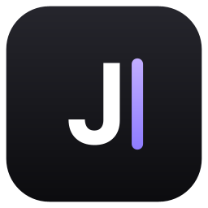
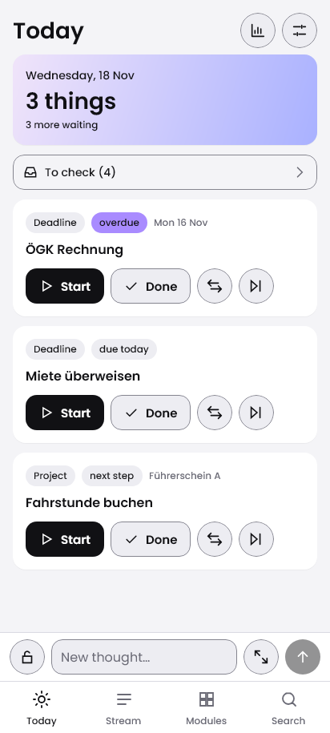
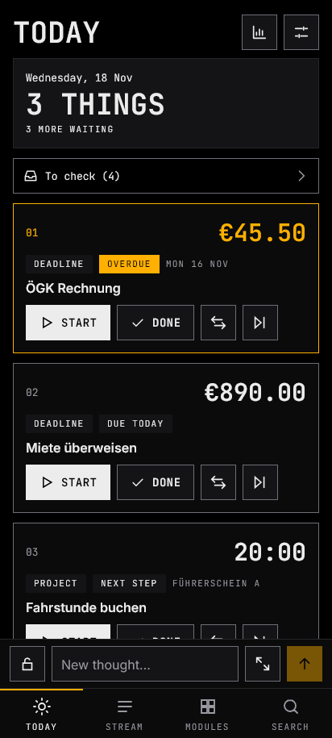
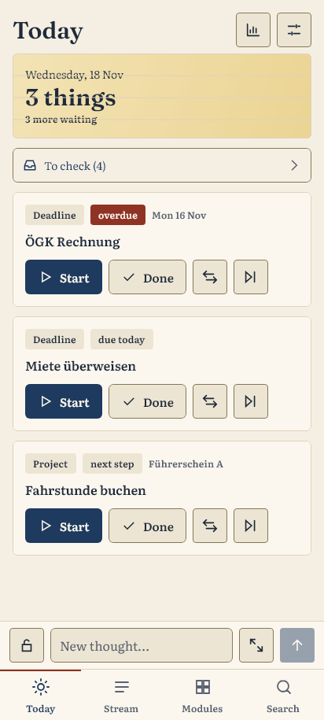

<h1 align="center">JavOS</h1>

One capture box for every thought. Android, Windows and macOS. Offline, no account.

<a href="https://ncy142.github.io/javos-download/"><b>Download page</b></a> · <a href="../../releases/latest">Latest release</a>

  
  
  

This repository only holds the download page and the release builds. The source code is private.
The builds are unsigned; install notes are on the download page.

Fonts: Poppins, SIL Open Font License (`assets/fonts/OFL.txt`).
